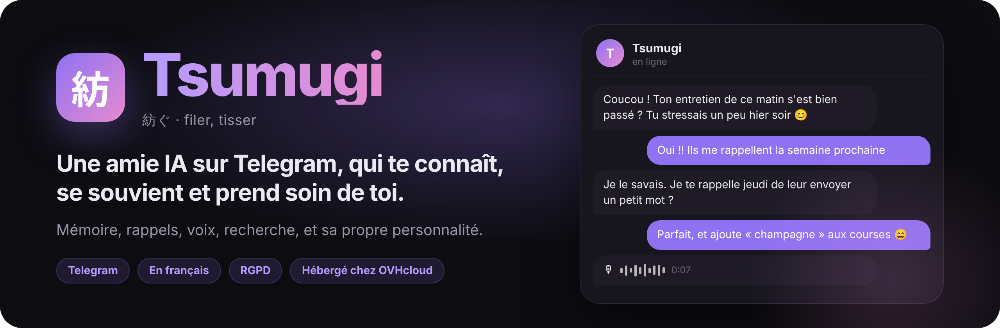
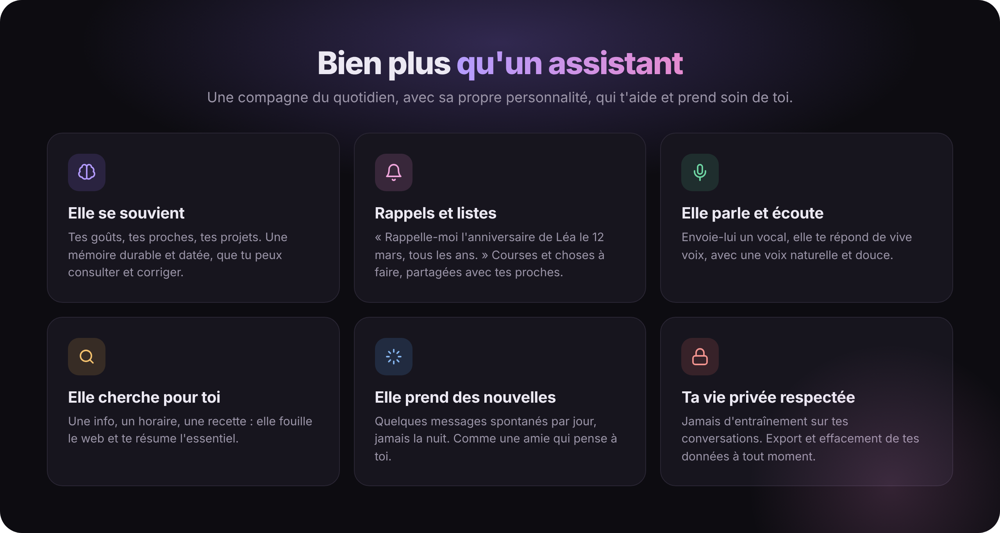
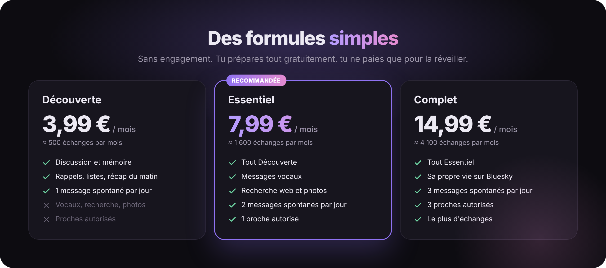

  

  
  
  

  
  
  
  
  
  
  
  

 

> [!NOTE]
> ***Tsumugi*** (紡) signifie « filer, tisser » en japonais. Fil après fil, conversation après conversation, ton agent tisse une relation avec toi : il retient ce qui compte, te rappelle l'essentiel et prend de tes nouvelles.

  

<b>✨ Le détail des fonctions</b>

 

| | Fonction | Ce que ça change pour toi |
|:-:|---|---|
| 🧠 | **Elle se souvient** | Tes goûts, tes proches, tes projets. Une mémoire durable et datée, que tu peux consulter et corriger depuis ton espace. |
| 🔔 | **Rappels et listes** | « Rappelle-moi l'anniversaire de Léa le 12 mars, tous les ans. » Courses et choses à faire, partagées avec tes proches. |
| 🎙️ | **Elle parle et écoute** | Envoie-lui un vocal, elle te répond de vive voix. |
| 🔎 | **Elle cherche pour toi** | Une info, un horaire, une recette : elle fouille le web et te résume l'essentiel. |
| 💌 | **Elle prend des nouvelles** | Quelques messages spontanés par jour, jamais la nuit. |
| 🎭 | **Sa propre personnalité** | Un prénom, un caractère et des passions que tu choisis, et qu'elle fait vivre. |

  

Prix TTC, sans engagement. Tu prépares tout gratuitement, tu ne paies que pour réveiller ton agent.

## 🧵 Les projets

<table>
  <tr>
    <td width="50%" valign="top">
      <h3>🤖 Tsumugi</h3>
      
Le <b>moteur</b> de l'agent : mémoire datée, rappels, listes, voix, recherche web, autonomie et garde-fous.

      

        
        
      

    </td>
    <td width="50%" valign="top">
      <h3>🛰️ TsugumiFleet</h3>
      
La <b>plateforme</b> : espace client, inscription en libre-service, formules, facturation, rapports et pilotage de toute la flotte d'agents.

      

        
        
      

    </td>
  </tr>
</table>

## 🛠️ Comment c'est construit

| | |
|---|---|
| ⚙️ **Moteur** | .NET 10, ASP.NET Core minimal, **zéro paquet NuGet**. Chaque ligne est lisible et maîtrisée. |
| 🧩 **Isolation** | Un agent = une instance isolée, avec sa propre mémoire SQLite, son propre bot Telegram et sa propre clé de modèle plafonnée. |
| 🧠 **Modèles** | Via OpenRouter, avec des fournisseurs qui ne conservent pas les données. |
| 🎧 **Voix** | Whisper pour écouter, Edge TTS pour parler, Piper en secours. |
| ☁️ **Hébergement** | OVHcloud, servi en HTTPS par Caddy. |

## 🔒 Vie privée et sécurité

- 🚫 Tes conversations ne servent **jamais** à entraîner un modèle, ni à de la publicité.
- 🧱 Chaque agent ne voit que ses propres données, et n'a accès à **aucun** de tes comptes que tu ne lui aies pas confié.
- 📦 Tu peux **exporter** ou **effacer** toutes tes données depuis ton espace client, comme le prévoit le RGPD.

> [!IMPORTANT]
> Une faille de sécurité ? Écris à **support@tsumugi.cloud** plutôt que d'ouvrir un ticket public. Merci !

  

  <b>Tsumugi</b> · <a href="https://tsumugi.cloud">tsumugi.cloud</a> · <a href="mailto:support@tsumugi.cloud">support@tsumugi.cloud</a> 
  Tsumugi est une intelligence artificielle. Elle peut se tromper : vérifie toujours les informations importantes.

